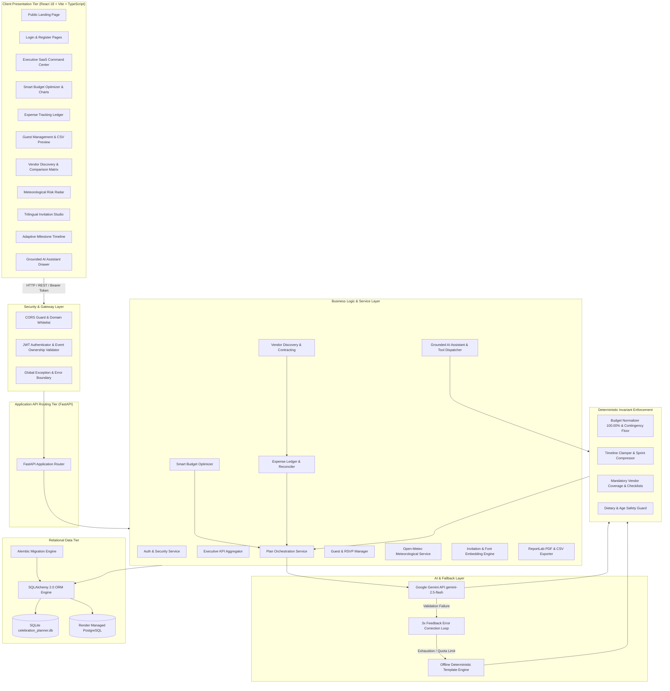
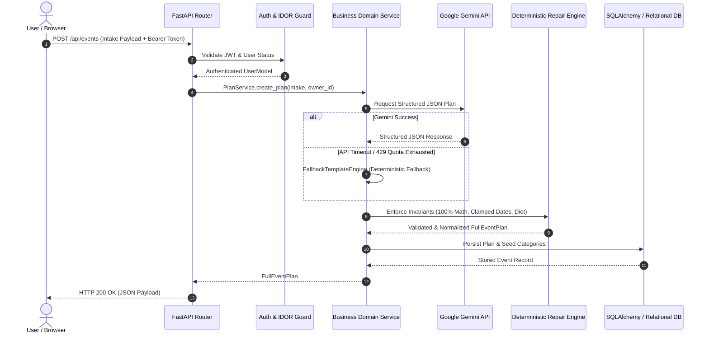

# ARCHITECTURE.md: Eventify AI Architectural Specification

An autonomous, full-stack event intelligence and orchestration SaaS platform engineered with deterministic mathematical repair engines, structured Google Gemini JSON outputs, multi-tenant database isolation, and an interactive React frontend.

---

## 1. High-Level Architecture Overview

---

## 2. Core Subsystems

### A. Authentication, Security & Data Isolation (`backend/app/auth_service.py` & `core/security.py`)
- **Token Mechanism**: Standard RFC 7519 HMAC-SHA256 JWT tokens with a default 7-day validity period.
- **Password Hashing**: NIST-compliant PBKDF2-HMAC-SHA256 with 100,000 hash iterations and unique per-user cryptographically random 16-byte hex salts.
- **IDOR Protection (`verify_event_ownership`)**: Every private API route verifies that the target `event_id` exists and is owned by the authenticated `user_id`. Cross-user access attempts to events, expenses, guests, or vendor contracts return HTTP 403 Forbidden.
- **CORS Configuration**: Dynamic, environment-driven origin validation preventing unauthorized cross-origin requests while disallowing wildcard `*` with credentials.

### B. Plan Intake & Invariant Validation (`backend/app/plan_service.py`)
- Ingests event parameters: event type (`wedding`, `birthday`, `community`), target date, city, guest count, total budget, currency, theme style, cultural traditions, dietary constraints, must-haves, and age group details.
- Validated via strict Pydantic v2 schemas.
- Supports 1-click presets for instant demo plan generation.

### C. Generative AI Engine & Fallback Mechanism (`backend/app/gemini_client.py` & `fallback_engine.py`)
- Connects to Google Gemini (`gemini-2.5-flash`) via the `google-genai` SDK.
- Enforces strict structured JSON schema outputs.
- **3-Turn Feedback Retry Loop**: Captures Pydantic schema validation failures or JSON decode exceptions and returns the precise error to Gemini in a follow-up prompt to guide self-correction.
- **Zero-Crash Fallback**: Automatically activates `FallbackTemplateEngine` if `GEMINI_API_KEY` is missing, invalid, or exhausted (HTTP 429), generating authentic celebration plans without returning 500 server errors.

### D. Deterministic Post-Processing & Repair Engine (`backend/app/repair_engine.py`)
- **Budget Normalization**: Guarantees that percentages sum to **exactly 100.00%** and allocated amounts match total budget down to the penny via high-precision Python `Decimal` arithmetic. Enforces a non-negotiable **5.00% to 10.00% Contingency Reserve**.
- **Timeline Clamping & Sprint Compression**: Restricts milestone due dates to `today <= due_date <= event_date`. Automatically triggers compressed sprint schedules when lead time is under 30 days, flagging critical vendor contracts as `HIGH RISK`.
- **Mandatory Vendor Injection**: Guarantees 100% presence of essential vendor categories for the event type with at least 4 verification checklist tasks each.
- **Dietary & Age Guard**: Automatically removes non-vegetarian items for vegetarian/Jain events and purges alcohol recommendations from children's parties.

### E. AI Smart Budget Optimizer (`backend/app/budget_optimizer.py`)
- **Natural Language Parsing**: Robust multi-pattern currency parser handling Indian numbering (`50 lakh`, `1.5 crore`, `₹50,00,000`), international formats (`5 million`), and raw digits (`5000000`).
- **Category Taxonomy & Collision Detection**: Analyzes compound categories (e.g. "Attire, Makeup & Priest") against standard domains and detects overlapping or duplicate category titles.
- **Category Protection**: Enables users to lock essential categories (e.g., Venue or Catering) against reductions during optimization passes.
- **Reallocation Balancing**: Rebalances category adjustments while maintaining total budget invariants.

### F. Smart Expense Tracking Ledger (`backend/app/expense_service.py`)
- Records individual financial transactions with payment status (`Paid`, `Pending`, `Refunded`), payment method, transaction dates, and itemized receipt notes.
- **Automated Budget Reconciliation**: Recalculates actual category spending upon expense insertion, update, or deletion, synchronizing real-time budget utilization across all views.
- **One-Click CSV Export**: Exports a formatted financial ledger for accounting and audit reconciliation.

### G. Guest Management & Attendance Tracking (`backend/app/guest_service.py`)
- Maintains guest profiles with categories (`VIP`, `Family`, `Friend`, `Colleague`), plus-one headcounts, dietary restrictions, and RSVP status (`Attending`, `Confirmed`, `Declined`, `Pending`).
- **Interactive CSV Bulk Import**: Parses raw CSV text, identifies missing or malformed rows, displays an interactive preview table, and bulk inserts deduplicated guest records.
- **Guest Roster CSV Export**: Formatted guest rosters ready for security desks and catering staff.

### H. Local Vendor Discovery & Comparison (`backend/app/vendor_service.py`)
- Pre-seeded verified vendor directory categorized by service type, city, price tier, and star rating.
- **AI Recommendation Search**: Evaluates user prompts against active event parameters and vendor offerings.
- **Side-by-Side Comparison**: Compares quotes, pros, and cons to aid selection.
- **Advance Expense Sync**: Booking an advance payment automatically posts a synchronized transaction to the Expense Tracking ledger.

### I. Meteorological Intelligence Radar (`backend/app/weather_service.py`)
- Resolves event destination coordinates via Open-Meteo Forward Geocoding API.
- Retrieves 16-day live hourly forecasts and 10-year historical climate averages.
- Computes atmospheric risk scores for Heat Stress, Rain Probability, and Wind Gusts.
- **One-Click Timeline Mitigations**: Appends weather contingency tasks to the active event schedule with duplicate prevention.

### J. Cultural Trilingual Invitation Studio (`backend/app/invitation_service.py`)
- Generates localized invitation copy in **English**, **Hindi**, and **Gujarati** with authentic cultural greetings and Ganesh mantras.
- **Embedded Unicode Gujarati Typography**: Embeds `Noto Sans Gujarati` TrueType fonts directly into ReportLab canvas rendering to eliminate missing glyphs (`.notdef` black boxes).
- **Dynamic Layout Adaptation**: Computes typography and vertical layout spacing based on text length to minimize awkward canvas whitespace.
- Generates high-resolution **PNG canvas cards**, formatted **PDF documents**, and pre-populated **WhatsApp share links**.

### K. Grounded AI Assistant & Tool Execution (`backend/app/chat_service.py`)
- Grounded conversational assistant maintaining multi-turn chat history.
- Executes structured tool mutations (`move_budget`, `adjust_event_date`, `update_vendor_status`, `update_task_status`, `add_custom_task`, `add_personalized_idea`).
- Routes all modifications through `DeterministicRepairEngine` to prevent state corruption.

### L. Executive Command Center (`backend/app/executive_service.py`)
- Aggregates 8 real-time cross-event operational KPIs.
- Computes upcoming event countdowns, spending velocity, attendance ratios, and an auditable activity feed.

---

## 3. Data Flow & Request Lifecycle

---

## 4. Security Invariants

1. **All Secrets from Environment**: Zero hardcoded API keys or cryptographic secrets in source code.
2. **Password Hashing**: PBKDF2-HMAC-SHA256 with 100,000 iterations and random salt; plaintext passwords are never stored.
3. **Data Isolation**: Strict user-level event ownership verification preventing IDOR vulnerabilities.
4. **CORS Hardening**: Strict origin whitelisting; wildcard `*` is never combined with credentials.
5. **Safe Database Operations**: Parameterized SQLAlchemy ORM queries protecting against SQL injection.
