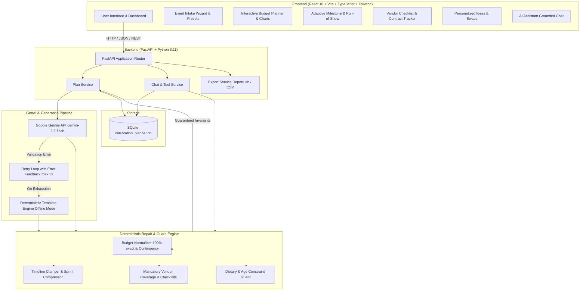
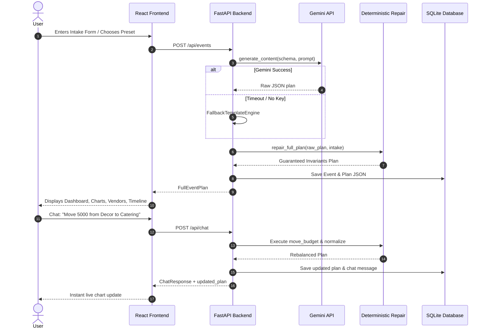

# ARCHITECTURE.md: Celebration & Event Planner Assistant

An autonomous, full-stack GenAI planning platform engineered with deterministic post-processing repair layers, structured Gemini JSON outputs, SQLite persistence, and an interactive React frontend.

---

## 1. High-Level Architecture Diagram

---

## 2. Core Subsystems

### A. Intake & Invariant Validation (`EventIntake`)
- Captures event type (`wedding`, `birthday`, `community`), target date, city, guest count, total budget, currency, theme, cultural traditions, dietary constraints, must-haves, and age group details.
- Validated via Pydantic v2 schemas.

### B. GenAI Integration & Retry Loop (`GeminiClient`)
- Communicates with Google Gemini API (`gemini-2.5-flash`) via `google-genai`.
- Enforces structured JSON output matching domain schemas.
- If JSON decoding or Pydantic validation fails, feeds the exact error back to Gemini in a retry prompt (up to 3 attempts).
- Automatically routes to `FallbackTemplateEngine` if offline, without API key, or upon retry exhaustion.

### C. Deterministic Post-Processing & Repair Engine (`DeterministicRepairEngine`)
- **Budget Normalization**: Guarantees that percentages sum to 100.00% and amounts sum to the exact total budget down to the penny. Enforces a 5-10% contingency reserve.
- **Timeline Clamping & Compression**: Clamps dates between `today` and `event_date`. If lead time is < 30 days, activates a compressed sprint schedule and flags critical bookings as high-risk. Generates a day-of hourly run-of-show.
- **Mandatory Vendor Injection**: Guarantees 100% mandatory categories are present for the event type with >= 4 checklist verification items each.
- **Dietary & Age Guard**: Cleanses food items violating vegetarian, Jain, or vegan constraints; cleanses alcoholic items from kids parties.

### D. Grounded AI Chat Assistant & Tool Calling (`ChatService`)
- Grounded in active plan data to answer questions about budget status, days left, vendor bookings, and timelines.
- Dispatches tool actions:
  - `move_budget(from_cat, to_cat, amount_or_percent)`
  - `adjust_event_date(new_date)`
  - `update_vendor_status(category, status)`
  - `update_task_status(task_id, status)`
  - `add_custom_task(title, date)`
  - `add_personalized_idea(category, title)`
- Every tool call executes through the repair engine, keeping the plan 100% consistent.

### E. Persistence & Export Engine (`ExportService`)
- SQLite storage via SQLAlchemy (`EventModel`, `ChatMessageModel`).
- PDF generation using ReportLab with custom tables and typography.
- Multi-section CSV export for spreadsheets.

---

## 3. Data Flow Diagram

