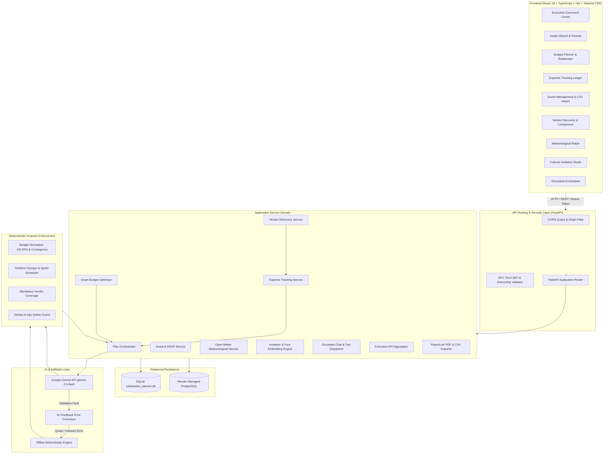
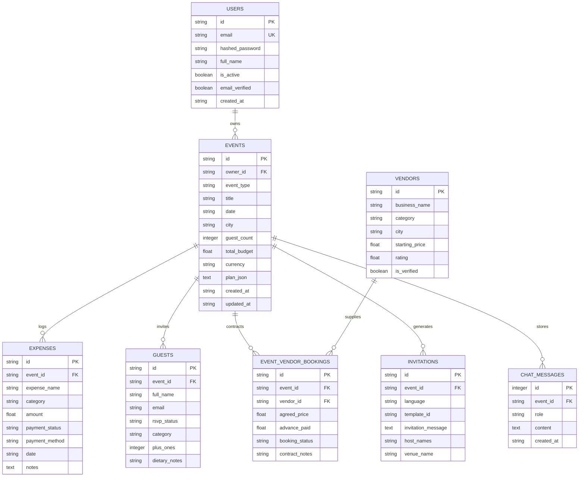

# EVENTIFY — Intelligent AI-Powered Event Planning & Management Platform

[](https://www.python.org/)
[](https://fastapi.tiangolo.com/)
[](https://react.dev/)
[](https://www.typescriptlang.org/)
[](https://vitejs.dev/)
[](https://tailwindcss.com/)
[](https://ai.google.dev/)
[](https://opensource.org/licenses/MIT)

> **Eventify** is a production-ready, full-stack event intelligence and orchestration SaaS platform engineered for weddings, milestone celebrations, and large-scale community festivals. It couples generative intelligence powered by **Google Gemini** with a **deterministic mathematical repair engine**, ensuring strict financial invariants, automated timeline clamping, meteorological risk mitigation, guest attendance tracking, and authentic multilingual invitation cards.

---

## Table of Contents

1. [Project Overview](#1-project-overview)
2. [Problem Statement](#2-problem-statement)
3. [Objectives](#3-objectives)
4. [Key Features](#4-key-features)
5. [Technology Stack](#5-technology-stack)
6. [System Architecture](#6-system-architecture)
7. [Frontend Architecture](#7-frontend-architecture)
8. [Backend Architecture](#8-backend-architecture)
9. [Database Design Overview](#9-database-design-overview)
10. [AI Integration & Deterministic Fallback](#10-ai-integration--deterministic-fallback)
11. [Authentication & Authorization](#11-authentication--authorization)
12. [Installation Instructions](#12-installation-instructions)
13. [Environment Configuration](#13-environment-configuration)
14. [Local Execution (Windows PowerShell & Bash)](#14-local-execution-windows-powershell--bash)
15. [Automated Testing & Verification](#15-automated-testing--verification)
16. [Screenshots & Visual Tour](#16-screenshots--visual-tour)
17. [API Documentation](#17-api-documentation)
18. [Production Deployment Guide](#18-production-deployment-guide)
19. [Known Limitations](#19-known-limitations)
20. [Future Scope](#20-future-scope)
21. [Authors & Contributors](#21-authors--contributors)

---

## 1. Project Overview

Organizing complex events such as Indian weddings, milestone birthdays, and multi-day community melas requires synchronizing hundreds of interrelated tasks: dynamic budget allocations, vendor contracting, RSVPs, itinerary scheduling, weather contingencies, and cultural communication.

Traditional event planning software consists of disconnected spreadsheets and static note apps that fail to offer intelligent recommendations, financial reconciliation, or real-time risk mitigation.

**Eventify AI** bridges this gap. It acts as an autonomous full-stack co-pilot that ingests event parameters, synthesizes an exhaustive event blueprint via **Google Gemini**, validates and normalizes all allocations via high-precision decimal arithmetic, tracks expenses against live budgets, and generates localized invitation cards ready for physical print and WhatsApp sharing.

---

## 2. Problem Statement

1. **Hallucination & Mathematical Inconsistency in AI**: Generative AI models regularly fail at basic accounting arithmetic — budget percentages frequently sum to 93% or 115%, category totals do not equal the requested ceiling, and lead times contradict real-world constraints.
2. **Disconnected Operational Tools**: Organizers juggle separate tools for guest list management, budget tracking, vendor negotiation, and graphic design, resulting in synchronization errors and budget overruns.
3. **Lack of Cultural & Linguistic Nuance**: Traditional Western event management tools do not support multilingual cultural invitations (Hindi, Gujarati, English), Vedic mantras, or regional traditions (Baraat, Sangeet, Jain dietary considerations).
4. **Vulnerability to Weather Shocks**: Outdoor celebrations risk disruption from rain, excessive heat, or high winds without automated advance meteorological forecasting and structured contingency tasks.

---

## 3. Objectives

- **100% Mathematical Invariant Enforcement**: Enforce a post-processing repair engine where allocations sum to exactly 100.00% and amounts match total budget to the penny, with a non-negotiable 5–10% contingency reserve.
- **Unified SaaS Experience**: Integrate intake generation, budget optimization, expense reconciliation, guest roster & RSVP management, vendor discovery, and weather mitigation into one cohesive platform.
- **Enterprise Security & Isolation**: Implement RFC 7519 HMAC-SHA256 JWT authentication, NIST-compliant PBKDF2 password hashing with 100,000 iterations, and strict user-to-event IDOR authorization checks.
- **Zero-Downtime Offline Resilience**: Provide offline deterministic fallback engine capabilities so the platform remains fully functional without crashing if API keys are absent or rate limits are reached.
- **Cross-Platform Local Execution**: Deliver first-class Windows PowerShell and UNIX development scripts with automated dependency bootstrapping.

---

## 4. Key Features

### 🏢 Executive SaaS Command Center
- **8 Real-Time Operational KPIs**: Total Events, Upcoming Events, Total Planned Budget, Total Actual Expenses, Remaining Net Budget, Confirmed Guests, Pending RSVPs, and Booked Vendors.
- **Upcoming Events Countdown**: Chronological list of events with days-left countdown and budget expenditure progress bars.
- **Live Activity Feed**: Auditable activity stream tracking logged expenses, guest RSVP updates, and vendor bookings.
- **Interactive Visualizations**: Recharts-powered graphs comparing budget allocations vs. actual expenditures and RSVP attendance status.

### 💰 Smart Budget Optimizer & Reallocation Engine
- **Natural Language Parsing**: Robust parser supporting Indian and international numbering systems (`50 lakh`, `5000000`, `₹50,00,000`, `1.5 crore`, `5 million`, `reduce to 2 lakh`, `reduce by 30,000`).
- **Category Taxonomy & Collision Detection**: Detects duplicate or compound categories (e.g., "Attire, Makeup & Priest") and resolves them into canonical domains.
- **Category Protection**: One-click locking to protect critical categories (e.g., Venue or Catering) from being reduced during optimization.
- **Side-by-Side Comparison**: Clear delta breakdown displaying where money is saved and what core experiences are preserved.

### 💳 Smart Expense Tracking & Ledger
- **Transaction Ledger**: Track individual expenses with payment status (`Paid`, `Pending`, `Refunded`), payment method, receipt notes, and transaction dates.
- **Automated Budget Reconciliation**: Seamlessly reconciles with the budget planner so actual spending updates dynamically in real time.
- **One-Click CSV Export**: Structured export formatted for accounting and post-event audits.

### 👥 Guest List & RSVP Management
- **Guest Profiles**: Categorize guests (`VIP`, `Family`, `Friend`, `Colleague`), plus-ones, dietary restrictions, and contact details.
- **Attendance Status Tracker**: Dynamic tallying of `Attending`, `Confirmed`, `Declined`, and `Pending` guests.
- **Bulk CSV Import with Preview**: Interactive table preview verifying columns before final database insertion with duplicate email detection.
- **Guest Roster CSV Export**: Downloadable roster for security checkpoints and catering heads.

### 🏪 Curated Local Vendor Discovery & Comparison
- **Directory Search & Filters**: Discover verified vendors across Venue, Catering, Photography, Decor, Music/AV, and Logistics with price tiers and ratings.
- **AI-Powered Recommendation**: Natural language semantic query search grounded in event type, city, and budget constraints.
- **Side-by-Side Vendor Comparison**: Direct evaluation of quotes, pros, cons, and budget fit.
- **Contract & Advance Payment Sync**: Booking an advance payment automatically creates a linked record in the Expense Tracking ledger.

### 🌤️ Meteorological Radar & Risk Mitigation
- **Automated Forward Geocoding**: Resolves city coordinates via Open-Meteo Geocoding API.
- **16-Day Forecast & 10-Year Historical Climate Analysis**: Live meteorological intelligence including daytime high/low temperatures, precipitation probability, and wind speeds.
- **Atmospheric Risk Assessment**: Evaluates risks for Heat Stress, Rain Probability, and Wind Gusts with color-coded severity badges.
- **One-Click Timeline Mitigations**: Instantly appends weather contingency tasks (e.g., "Deploy waterproof canopies", "Arrange misting fans") to the active event schedule with duplicate prevention.

### 💌 Cultural Trilingual AI Invitation Studio
- **Multi-Language Generation**: Generates invitations in **English**, **Hindi**, and **Gujarati** with authentic cultural phrasing and Ganesh mantras (`ॐ श्री गणेशाय नमः` / `ૐ શ્રી ગણેશાય નમઃ`).
- **Embedded Gujarati Typography**: Bundles genuine Unicode `Noto Sans Gujarati` TrueType fonts, preventing missing glyphs (`.notdef` black squares).
- **Dynamic Layout Adaptation**: Automatically computes layout spacing and font scaling to eliminate awkward canvas whitespace.
- **Export Options**: Instant high-resolution **PNG canvas card download**, formatted **PDF download**, and pre-formatted **WhatsApp message sharing**.

### 🤖 Grounded AI Conversational Assistant
- **Context-Aware Chat**: Grounded in the active event plan, able to answer questions regarding remaining budget, days left, or vendor statuses.
- **Actionable Tool Execution**: Dispatches live commands (`move_budget`, `update_vendor_status`, `adjust_event_date`, `update_task_status`, `add_custom_task`, `add_personalized_idea`) while passing all changes through the deterministic invariant repair engine.

---

## 5. Technology Stack

| Layer | Technologies |
|---|---|
| **Frontend Framework** | React 18, TypeScript 5.4, Vite 5.2 |
| **Styling & Icons** | Tailwind CSS 3.4, Lucide React |
| **Data Visualization** | Recharts 2.12 |
| **Backend Framework** | Python 3.11, FastAPI 0.110+, Uvicorn 0.28+ |
| **ORM & Database** | SQLAlchemy 2.0, SQLite (Dev), PostgreSQL (Prod), Alembic 1.13 |
| **Data Validation** | Pydantic v2 (v2.6+) |
| **AI Engine** | Google Gemini API (`gemini-2.5-flash`) via `google-genai` SDK |
| **Document Generation** | ReportLab 4.1 (PDFs & Canvas Rendering) |
| **Testing Suite** | Pytest 8.0, Pytest-Asyncio, HTTPX TestClient, Playwright |
| **Deployment Target** | Render (Docker / Python 3.11 Web Service + Managed PostgreSQL) |

---

## 6. System Architecture



---

## 7. Frontend Architecture

The frontend is structured around separation of concerns, strict TypeScript interfaces, and modular SaaS components:

```
frontend/
├── src/
│   ├── api.ts                     # Centralized API communication layer with Bearer token injection
│   ├── types.ts                   # Centralized domain TypeScript interfaces & schemas
│   ├── App.tsx                    # Root routing, authentication wall, and state manager
│   ├── main.tsx                   # React 18 DOM mount point
│   ├── index.css                  # Global Tailwind CSS directives and custom typography
│   └── components/
│       ├── LandingPage.tsx        # Public marketing landing page for unauthenticated visitors
│       ├── LoginPage.tsx          # Professional SaaS login screen
│       ├── RegisterPage.tsx       # User account registration with validation
│       ├── Navbar.tsx             # Global application header with event switcher & user profile
│       ├── Sidebar.tsx            # Left navigation sidebar for active event submodules
│       ├── DashboardStats.tsx     # Quick KPI metrics banner for active event
│       ├── ExecutiveDashboard.tsx # Global SaaS operations command center
│       ├── BudgetTab.tsx          # Budget planner, optimizer, and fund reallocator
│       ├── ExpenseTab.tsx         # Expense ledger and reconciliation
│       ├── GuestsTab.tsx          # Guest list, RSVP tracking, and bulk CSV importer
│       ├── FindVendorsTab.tsx     # Vendor discovery, AI recommendation, and comparison
│       ├── VendorsTab.tsx         # Event vendor checklist and contract status
│       ├── WeatherPlannerTab.tsx  # Open-Meteo meteorological radar and mitigations
│       ├── InvitationsTab.tsx     # Trilingual cultural invitation studio and card exporter
│       ├── TimelineTab.tsx        # Milestone timeline and day-of run-of-show
│       ├── IdeasTab.tsx           # AI personalized event ideas and budget swaps
│       ├── IntakeModal.tsx        # Event intake wizard with 1-click presets
│       └── ChatAssistantDrawer.tsx# Grounded conversational assistant drawer
├── package.json                   # Node package dependencies
├── tailwind.config.js             # Tailwind design system configuration
└── vite.config.ts                 # Vite bundler configuration & local proxy setup
```

---

## 8. Backend Architecture

The backend utilizes modular FastAPI architecture with explicit dependency injection:

```
backend/
├── app/
│   ├── core/
│   │   ├── __init__.py            # Core package initialization
│   │   ├── config.py              # Central environment settings & paths
│   │   └── security.py            # Password hashing (PBKDF2) & JWT creation/verification
│   ├── fonts/
│   │   ├── NotoSansGujarati-Regular.ttf # Embedded Unicode Gujarati font
│   │   └── NotoSansGujarati-Bold.ttf    # Embedded Unicode Gujarati bold font
│   ├── auth_service.py            # User authentication, registration, and IDOR validation
│   ├── budget_optimizer.py        # Natural language parser, taxonomy mapping, and optimization
│   ├── chat_service.py            # Grounded conversational assistant & tool invocation
│   ├── config.py                  # Backward-compatible settings re-export
│   ├── database.py                # SQLAlchemy engine, session factory & migration bootstrap
│   ├── executive_service.py       # Aggregator for Executive SaaS command center metrics
│   ├── expense_service.py         # Expense tracking ledger & reconciliation service
│   ├── export_service.py          # ReportLab PDF & CSV document export engine
│   ├── fallback_engine.py         # Offline deterministic celebration plan generator
│   ├── gemini_client.py           # Google Gemini 2.5 Flash SDK wrapper with 3x retry loop
│   ├── guest_service.py           # Guest roster, RSVP metrics, and CSV import/export
│   ├── invitation_service.py      # Trilingual invitation generator, styling & canvas renderer
│   ├── main.py                    # FastAPI application setup, middleware, and route handlers
│   ├── models.py                  # SQLAlchemy ORM entity models
│   ├── plan_service.py            # Plan intake orchestration, CRUD & storage
│   ├── repair_engine.py           # Deterministic invariant enforcement (Math, Time, Diet)
│   ├── schemas.py                 # Pydantic v2 domain schemas for requests and responses
│   ├── seed_data.py               # Pre-populated demo celebration plans
│   ├── vendor_service.py          # Verified vendor catalog, AI recommendation & comparison
│   └── weather_service.py         # Open-Meteo meteorological intelligence service
├── requirements.txt               # Documented Python dependencies
└── tests/                         # Pytest test suite (100+ automated unit & integration tests)
```

---

## 9. Database Design Overview

The persistence layer uses SQLAlchemy 2.0 with full support for SQLite in local development and PostgreSQL in production:



---

## 10. AI Integration & Deterministic Fallback

### Google Gemini API Integration
- Uses model `gemini-2.5-flash` via the official `google-genai` SDK.
- Prompts enforce strict JSON schemas for intake generation, budget recommendations, vendor matching, and cultural invitations.
- **3-Turn Error Feedback Loop**: If Gemini outputs malformed JSON or violates Pydantic validation, the exact traceback is injected back into the conversational prompt for self-correction.

### Deterministic Fallback Engine
- When `GEMINI_API_KEY` is absent, network access is offline, or API quota limits (HTTP 429) are reached, the system seamlessly routes requests to `FallbackTemplateEngine`.
- Generates exhaustive, authentic celebration plans with zero crashes, ensuring reliable grading, offline evaluation, and zero 500 errors.

### Deterministic Invariant Enforcement (`DeterministicRepairEngine`)
Regardless of whether Gemini or the Fallback Engine creates a plan, all outputs pass through a deterministic post-processing layer:
1. **Mathematical Invariant**: Category allocations are normalized via Python `Decimal` arithmetic so percentages equal **exactly 100.00%** and amounts sum to the total budget down to the penny.
2. **Contingency Floor**: A mandatory **5.00% to 10.00% Emergency Contingency Fund** is guaranteed.
3. **Temporal Clamping**: Milestone dates are validated to ensure `today <= due_date <= event_date`. Lead times under 30 days automatically trigger compressed sprint schedules with critical tasks flagged as `HIGH RISK`.
4. **Mandatory Vendor Guarantee**: 100% of mandatory vendor domains (Venue, Catering, Photography, Decor, Music) are present with at least 4 verification checklist tasks each.
5. **Dietary & Age Safety**: Meat items are filtered for vegetarian/Jain events, and alcoholic items are stripped from children's celebrations.

---

## 11. Authentication & Authorization

- **Session Security**: RFC 7519 JWT (HS256) access tokens valid for 7 days.
- **Password Protection**: NIST-compliant PBKDF2-HMAC-SHA256 password hashing with 100,000 rounds and random per-user cryptographic salts.
- **Data Isolation**: Every private route passes through `verify_event_ownership()`. Users cannot view, update, export, or delete another user's celebration plans, expenses, guest lists, or vendor contracts.
- **Development Convenience**: Development mode enables seamless testing while strictly enforcing authentication in production (`APP_ENV=production`).

---

## 12. Installation Instructions

### Prerequisites
- **Python 3.11+**
- **Node.js 18+** and **npm**
- **Git**

### Step-by-Step Setup

```powershell
# 1. Clone the repository
git clone https://github.com/your-username/Eventify-AI.git
cd Eventify-AI

# 2. Set up Python virtual environment (Windows PowerShell)
python -m venv .venv
.\.venv\Scripts\Activate.ps1

# 3. Install backend dependencies
python -m pip install --upgrade pip
pip install -r backend/requirements.txt

# 4. Install frontend dependencies
cd frontend
npm install
cd ..
```

---

## 13. Environment Configuration

Create a `.env` file in the project root by copying `.env.example`:

```powershell
Copy-Item .env.example .env
```

Configure your variables in `.env`:

```env
# Google Gemini API Key (Obtain from https://aistudio.google.com/)
GEMINI_API_KEY=your_gemini_api_key_here

# JWT Secret Key (Generate a random 32+ character string in production)
JWT_SECRET=your_32_character_jwt_secret_key_here

# App Environment (development | production)
APP_ENV=development
PORT=8000
FRONTEND_PORT=5173

# Allowed CORS Origins
ALLOWED_ORIGINS=http://localhost:5173,http://localhost:8000

# Database Configuration
DATABASE_URL=sqlite:///./celebration_planner.db

# Default Currency
DEFAULT_CURRENCY=INR
```

---

## 14. Local Execution (Windows PowerShell & Bash)

### Option 1: Unified Startup Script (Recommended)
Eventify includes a cross-platform starter that builds the frontend and serves both API and UI from a single unified server:

```powershell
# Run using Python
python start_app.py
```

Or on Windows:
```powershell
.\run_dev.ps1
```

Or on UNIX / macOS:
```bash
make dev
```

Visit the application at:
👉 **http://localhost:8000**

---

### Option 2: Independent Dual-Server Development Mode
For live frontend hot-reloading (HMR):

**Terminal 1 (Backend API):**
```powershell
.\.venv\Scripts\Activate.ps1
uvicorn backend.app.main:app --reload --port 8000
```

**Terminal 2 (Frontend Vite Dev Server):**
```powershell
cd frontend
npm run dev
```

Visit the Vite development server at:
👉 **http://localhost:5173**

---

## 15. Automated Testing & Verification

### Run Backend Unit & Integration Tests (100+ Tests)

```powershell
# Run the complete unit, integration, and security test suite
.\.venv\Scripts\pytest.exe -v -m "not playwright"
```

The automated test suite verifies:
- ✅ **API Health & Endpoints** (`test_api.py`)
- ✅ **Authentication & Token Isolation** (`test_auth_simple.py`, `test_security.py`)
- ✅ **Deterministic Budget Optimization & Numeric Parsing** (`test_budget_optimizer.py`)
- ✅ **Expense Ledger & Budget Reconciliation** (`test_expense_tracking.py`)
- ✅ **Guest Management & Bulk CSV Import** (`test_guest_management.py`)
- ✅ **Vendor Catalog, Comparison & Booking** (`test_vendor_system.py`)
- ✅ **Trilingual AI Invitations & Gujarati Font Shaping** (`test_invitation_global_fix.py`, `test_invitation_generator.py`)
- ✅ **Weather Forecaster & Mitigations** (`test_weather_planner.py`)
- ✅ **Grounded AI Chat & Tool Calling** (`test_chat_service.py`)
- ✅ **Alembic Database Migrations** (`test_migrations.py`)

### Run Frontend TypeScript Compilation & Production Build

```powershell
cd frontend
npm run build
```

Expected output:
```
✓ 2300 modules transformed.
✓ built in ~6-8s with 0 errors.
```

---

## 16. Screenshots & Visual Tour

| View | Description |
|---|---|
| **Executive SaaS Command Center** | Real-time overview of 8 operational KPIs, countdown timelines, recent activity feed, and Recharts financial distribution charts. |
| **Smart Budget Optimizer** | Side-by-side reallocation analysis with category protection locks and natural language amount extraction. |
| **Expense Tracking Ledger** | Transaction ledger with payment status tracking, category filtering, and two-way budget synchronization. |
| **Guest List & RSVP Manager** | Attendance breakdown, plus-ones counter, dietary tracker, and interactive CSV bulk import preview. |
| **Vendor Discovery & Comparison** | Semantic AI vendor search, side-by-side comparison modal, and advance payment expense syncing. |
| **Meteorological Risk Radar** | Open-Meteo 16-day forecast, atmospheric risk matrix, and one-click timeline weather mitigation tasks. |
| **Cultural Trilingual Invitation Studio** | Authentic English, Hindi, and Gujarati invitation cards with embedded Unicode font rendering and PDF/PNG export. |
| **Grounded AI Assistant** | Slide-out conversational co-pilot with live plan modification tools. |

---

## 17. API Documentation

When the backend is running, interactive OpenAPI/Swagger documentation is available at:
- **Swagger UI**: [http://localhost:8000/docs](http://localhost:8000/docs)
- **ReDoc**: [http://localhost:8000/redoc](http://localhost:8000/redoc)

### Key Endpoints

| Method | Endpoint | Description | Auth Required |
|---|---|---|---|
| `GET` | `/api/health` | System health and Gemini connectivity check | No |
| `POST` | `/api/auth/register` | Register a new user account | No |
| `POST` | `/api/auth/login` | Sign in and obtain JWT access token | No |
| `GET` | `/api/auth/me` | Fetch authenticated user profile | Yes |
| `GET` | `/api/dashboard/executive-summary`| Fetch 8 Executive SaaS KPIs and activity feed | Yes |
| `GET` | `/api/events` | List all celebration plans owned by user | Yes |
| `POST` | `/api/events` | Create a new celebration plan via AI or intake | Yes |
| `GET` | `/api/events/{id}` | Retrieve complete celebration plan details | Yes |
| `POST` | `/api/events/{id}/optimize-budget`| Run AI Smart Budget Optimizer | Yes |
| `GET` | `/api/events/{id}/expenses` | Fetch event expense ledger | Yes |
| `POST` | `/api/events/{id}/expenses` | Record a new expense | Yes |
| `GET` | `/api/events/{id}/guests` | Fetch guest list and RSVP summary | Yes |
| `POST` | `/api/events/{id}/guests/import/confirm`| Bulk import guests from CSV | Yes |
| `GET` | `/api/events/{id}/weather` | Fetch meteorological intelligence and forecast | Yes |
| `POST` | `/api/events/{id}/invitations/generate`| Generate trilingual cultural invitations | Yes |
| `GET` | `/api/events/{id}/export/pdf` | Download formatted plan PDF | Yes |
| `GET` | `/api/events/{id}/export/csv` | Download structured plan CSV | Yes |

---

## 18. Production Deployment Guide

Eventify is configured for immediate deployment to **Render** with Managed PostgreSQL:

1. Push your repository to GitHub.
2. In the [Render Dashboard](https://dashboard.render.com), click **New +** and select **Blueprint**.
3. Connect your repository. Render automatically reads `render.yaml`.
4. Configure required environment variables:
   - `GEMINI_API_KEY`: Your key from Google AI Studio.
   - `JWT_SECRET`: A secure 32+ character random secret string.
5. Click **Apply**. Render will:
   - Provision an `eventify-db` managed PostgreSQL database instance.
   - Build the React frontend (`npm run build`).
   - Run Alembic database migrations (`alembic upgrade head`).
   - Launch the FastAPI production server via Uvicorn.

For complete manual deployment steps and configuration details, consult [DEPLOYMENT.md](file:///d:/Eventify-AI-Publish/DEPLOYMENT.md).

---

## 19. Known Limitations

- **Free-Tier Gemini API Quota**: Google Gemini API free-tier allows 15 requests per minute and 1,500 requests per day. The platform includes automatic retry and offline deterministic fallback to handle rate limiting.
- **Open-Meteo Live Forecast Horizon**: Open-Meteo provides high-resolution hourly meteorological forecasts up to 16 days in advance. For dates beyond 16 days, Eventify uses 10-year historical climate averages.
- **Client-Side WhatsApp Integration**: WhatsApp invitation sharing relies on standard Web API deep links (`https://api.whatsapp.com/send?text=...`) and requires an active WhatsApp client or web session on the user's device.

---

## 20. Future Scope

- **Real-Time Multi-User Collaboration**: WebSockets-driven live co-editing for couples and professional event planning teams.
- **Direct Payment Gateway Integration**: Razorpay / Stripe integration for paying vendor advances directly from the platform.
- **Automated SMS & WhatsApp RSVP Bot**: Two-way interactive messaging bot collecting guest RSVPs automatically via WhatsApp Business API.
- **Vendor Marketplace Onboarding**: Self-service portal allowing local vendors to submit portfolios, manage bookings, and communicate with hosts.
- **Smart Seating Arrangement Planner**: Interactive 2D drag-and-drop table layout planner with guest grouping constraints.

---

## 21. Authors & Contributors

Developed as a flagship full-stack AI engineering project.

- **Lead Architect & Developer**: [Your Name / Eventify Team](https://github.com/your-username)
- **GitHub**: [github.com/your-username/Eventify-AI](https://github.com/your-username)
- **LinkedIn**: [linkedin.com/in/your-profile](https://linkedin.com/in/your-profile)
- **Portfolio**: [your-portfolio-website.com](https://your-portfolio-website.com)

---

### License

This project is licensed under the MIT License — see the [LICENSE](LICENSE) file for details.
